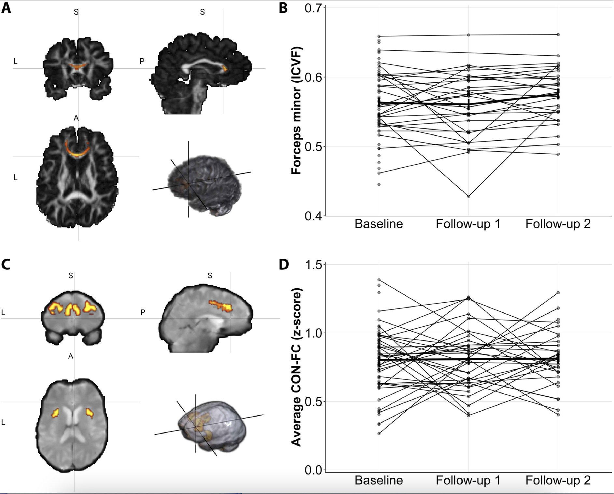

Adriana's research asks how aging and the earliest stages of cognitive decline alter cognition, behavior, and the organization of brain networks. The work moves between three levels: precise, theory-based measures of attention and memory; the functional and structural brain networks that support them; and the populations and interventions where those measures matter.

<ul class="rr-toc-themes">
<li class="rr-theme attention"><a href="#visual-attention">Visual attentionProcessing speed and capacity in the aging brain</a></li>
<li class="rr-theme networks"><a href="#brain-networks">Brain networksIntrinsic connectivity and white-matter pathways</a></li>
<li class="rr-theme decline"><a href="#cognitive-decline">Cognitive decline and dementiaFrom presymptomatic stages to mild cognitive impairment</a></li>
<li class="rr-theme lifestyle"><a href="#lifestyle-interventions">Lifestyle and interventionsTraining, physical activity, and diet</a></li>
<li class="rr-theme clinical"><a href="#clinical-neuroscience">Clinical neuroscienceMultiple sclerosis, Parkinson's disease, and depression</a></li>
<li class="rr-theme data"><a href="#data-science">Data scienceMachine learning on health and social data</a></li>
</ul>

::: {.rr-theme-section .rr-theme .attention}
[Visual attention]{.rr-theme-label}

## Processing speed and capacity in the aging brain {#visual-attention}

[Why does visual processing slow down with age, and which brain systems keep it efficient?]{.rr-question}

Much of daily life depends on how quickly the brain takes in visual information. Adriana uses Bundesen's theory of visual attention (TVA) to estimate, for each person, separable parameters such as visual processing speed and visual short-term memory capacity from whole- and partial-report tasks. Because these parameters are estimated independently of motor speed, they offer sensitive measures of attentional capacity in healthy aging and in patient groups, and they can be related directly to brain networks.

<ul class="rr-findings">
<li>Across 91 adults aged 20 to 77, lower connectivity within the cingulo-opercular network, particularly in the left insula, mediated the age-related slowing of visual processing speed.Ruiz-Rizzo et al., 2019, <a href="https://doi.org/10.1016/j.neurobiolaging.2018.09.014"><em>Neurobiology of Aging</em></a></li>
<li>Alertness training increased visual processing speed in healthy older adults, and pre-training cingulo-opercular connectivity predicted each person's training gain.Penning, Ruiz-Rizzo et al., 2021, <a href="https://doi.org/10.1177/0956797620965520"><em>Psychological Science</em></a> (shared first authorship)</li>
<li>Visual processing speed was associated with resting-state connectivity between right frontoparietal and visual networks, in specific frequency bands of the signal.Küchenhoff et al., 2021, <a href="https://doi.org/10.1111/ejn.15206"><em>European Journal of Neuroscience</em></a> (shared senior authorship)</li>
</ul>

[**Methods:** TVA-based whole and partial report, phasic alerting paradigms, resting-state fMRI, and diffusion tractography.]{.rr-methods-line}

### Selected publications {.unlisted}

::: {#pubs-attention}
:::

[All publications on visual attention](publications.qmd#category=Visual%20attention){.rr-more}
:::

::: {.rr-theme-section .rr-theme .networks}
[Brain networks]{.rr-theme-label}

## Intrinsic connectivity and white-matter pathways {#brain-networks}

[How does the brain's intrinsic organization support individual differences in cognition?]{.rr-question}

Even at rest, brain activity is organized into large-scale networks. Adriana studies how this intrinsic functional connectivity, and the white-matter pathways linking brain regions, relate to attention and memory. Her work maps separable attention functions onto distinct networks and characterizes how subsystems of the medial temporal lobes are embedded in the wider brain.

<ul class="rr-findings">
<li>In healthy young adults, separable visual attention parameters mapped onto particular intrinsic brain networks.Ruiz-Rizzo et al., 2018, <a href="https://doi.org/10.3389/fnhum.2018.00089"><em>Frontiers in Human Neuroscience</em></a></li>
<li>Subsystems of the human medial temporal lobes extend locally to amygdala nuclei and globally to a large-scale allostatic-interoceptive system, examined across three independent samples.Ruiz-Rizzo et al., 2020, <a href="https://doi.org/10.1016/j.neuroimage.2019.116404"><em>NeuroImage</em></a></li>
</ul>

[**Methods:** independent component analysis and dual regression, frequency-specific connectivity, probabilistic tractography, and diffusion tensor and neurite density (NODDI) metrics.]{.rr-methods-line}

### Selected publications {.unlisted}

::: {#pubs-networks}
:::

[All publications on brain networks](publications.qmd#category=Brain%20networks){.rr-more}
:::

::: {.rr-theme-section .rr-theme .decline}
[Cognitive decline and dementia]{.rr-theme-label}

## From presymptomatic stages to mild cognitive impairment {#cognitive-decline}

[What are the earliest measurable signs that cognition is starting to decline?]{.rr-question}

The research follows decline from its earliest stages. It began in Colombia, with studies of families carrying the E280A mutation in the presenilin-1 gene, which causes early-onset familial Alzheimer's disease. It continues with older adults who report a decline that standard tests do not yet detect (subjective cognitive decline) and with patients with mild cognitive impairment. A methods chapter on diffusion tensor imaging in Alzheimer's research cautions against overinterpreting diffusion metrics and favors analyses of regions of interest or major white-matter tracts for biomarker studies.

<ul class="rr-findings">
<li>Patients with amnestic mild cognitive impairment due to Alzheimer's disease made more errors than matched controls when identifying overlapping shapes, and these errors correlated with reduced visual processing speed.Ruiz-Rizzo et al., 2017, <a href="https://doi.org/10.1016/j.neurobiolaging.2017.03.029"><em>Neurobiology of Aging</em></a></li>
<li>Older adults with subjective cognitive decline benefited less from perceptual detail when recognizing scenes, suggesting that their memory complaints may reflect a reduced availability of perceptual detail.Ruiz-Rizzo et al., 2022, <a href="https://doi.org/10.1093/arclin/acab061"><em>Archives of Clinical Neuropsychology</em></a></li>
<li>Subjective cognitive decline predicted lower cingulo-opercular network connectivity in older adults with lower neurite density in the forceps minor (see figure).Ruiz-Rizzo et al., 2022, <a href="https://doi.org/10.1016/j.neuroimage.2022.119662"><em>NeuroImage</em></a></li>
<li>In healthy older adults from the community, lower visual processing speed correlated with greater subjective cognitive complaints.Marrero-Polegre et al., 2023, <a href="https://doi.org/10.3389/fpsyt.2023.1063151"><em>Frontiers in Psychiatry</em></a></li>
</ul>

<figure class="rr-figure">

<figcaption>Forceps minor neurite density (A, B) and cingulo-opercular network functional connectivity (C, D) in older adults at baseline and two follow-ups, about 18 months apart. Each line is one participant.Figure from Ruiz-Rizzo et al. (2022), <a href="https://doi.org/10.1016/j.neuroimage.2022.119662"><em>NeuroImage</em> 263, 119662</a>. Reproduced unmodified under <a href="https://creativecommons.org/licenses/by-nc-nd/4.0/">CC BY-NC-ND 4.0</a>.</figcaption>
</figure>

[**Methods:** task fMRI, high-density event-related potentials, resting-state and diffusion MRI, latent growth curve modeling, and neuropsychological assessment.]{.rr-methods-line}

### Selected publications {.unlisted}

::: {#pubs-decline}
:::

[All publications on cognitive decline and dementia](publications.qmd#category=Cognitive%20decline%20and%20dementia){.rr-more}
:::

::: {.rr-theme-section .rr-theme .lifestyle}
[Lifestyle and interventions]{.rr-theme-label}

## Training, physical activity, and diet {#lifestyle-interventions}

[Can attention, memory, and brain connectivity in older age be supported by training and lifestyle?]{.rr-question}

Beyond describing change, the research tests factors that might support cognitive health: cognitive training of alertness, multicomponent physical activity, and dietary patterns, studied in training studies, a randomized controlled trial, and a longitudinal cohort. Outcomes are measured with the same theory-based attention parameters and multimodal MRI used elsewhere in the work, which makes results comparable across studies.

<ul class="rr-findings">
<li>In older adults from the DELCODE cohort (n = 376), fornix white-matter microstructure mediated the association between Mediterranean diet adherence and verbal episodic memory four years later.Ruiz-Rizzo et al., 2024, <a href="https://doi.org/10.1016/j.neurobiolaging.2024.01.012"><em>Neurobiology of Aging</em></a></li>
<li>Alertness training increased visual processing speed in healthy older adults. The study received the SCHUHFRIED Science Award 2020.Penning, Ruiz-Rizzo et al., 2021, <a href="https://doi.org/10.1177/0956797620965520"><em>Psychological Science</em></a></li>
</ul>

A 2026 preprint from the FIT4BRAIN randomized controlled trial, not yet peer reviewed, reports increases in NODDI-derived neurite density across white-matter tracts after physical exercise in healthy older adults ([medRxiv](https://doi.org/10.64898/2026.08.31.26361810)).

[**Methods:** randomized controlled trial design, training studies, longitudinal cohort analysis, and latent growth curve and mediation models.]{.rr-methods-line}

### Selected publications {.unlisted}

::: {#pubs-lifestyle}
:::

[All publications on lifestyle and interventions](publications.qmd#category=Lifestyle%20and%20interventions){.rr-more}
:::

::: {.rr-theme-section .rr-theme .clinical}
[Clinical neuroscience]{.rr-theme-label}

## Multiple sclerosis, Parkinson's disease, and depression {#clinical-neuroscience}

[What do attention measures and brain networks reveal in neurological and psychiatric conditions?]{.rr-question}

The same measures carry over to clinical populations, where cognitive symptoms are common but often poorly characterized.

<ul class="rr-findings">
<li>In 104 patients with relapsing-remitting multiple sclerosis, fatigue and low sleep quality were associated with distinct patterns of functional connectivity, even though the two symptoms were closely correlated.Ruiz-Rizzo et al., 2022, <a href="https://doi.org/10.1111/ene.15445"><em>European Journal of Neurology</em></a></li>
<li>Earlier work in Colombia characterized neuropsychological performance in major depression and in Parkinson's disease with different ages of onset.Ruiz-Rizzo et al., 2008 and 2009, <a href="https://doi.org/10.17533/udea.iatreia.4479"><em>Iatreia</em></a>; <a href="https://doi.org/10.33588/rn.4903.2008475"><em>Revista de Neurología</em></a></li>
</ul>

### Selected publications {.unlisted}

::: {#pubs-clinical}
:::

[All publications in clinical neuroscience](publications.qmd#category=Clinical%20neuroscience){.rr-more}
:::

::: {.rr-theme-section .rr-theme .data}
[Data science]{.rr-theme-label}

## Machine learning on health and social data {#data-science}

[How can statistical learning address problems that affect older adults inside and outside the clinic?]{.rr-question}

Adriana holds a specialization in applied statistics, and machine learning is part of her toolkit. One study applied supervised learning to open data on missing older adults in Colombia.

<ul class="rr-findings">
<li>Using open data on 7,855 cases of older adults reported missing in Colombia, gradient boosting classifiers performed best at predicting whether a missing older adult would be found; the time since the disappearance and the place where it occurred were among the most informative features.Ruiz-Rizzo, Archila-Meléndez, and González Veloza, 2022, <a href="https://doi.org/10.1007/s42001-022-00171-x"><em>Journal of Computational Social Science</em></a></li>
</ul>

### Selected publications {.unlisted}

::: {#pubs-data}
:::

[All publications in data science](publications.qmd#category=Data%20science){.rr-more}
:::
